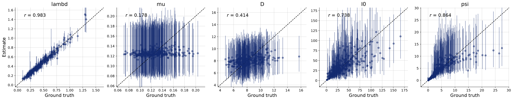
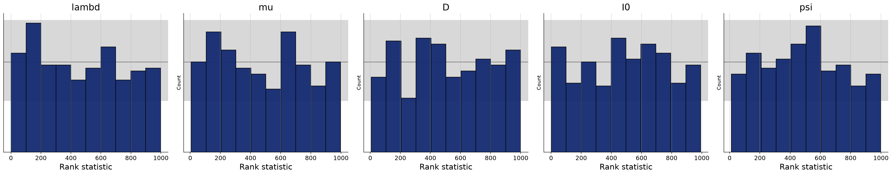
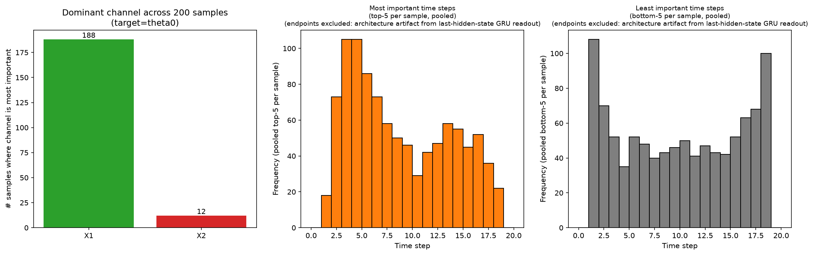
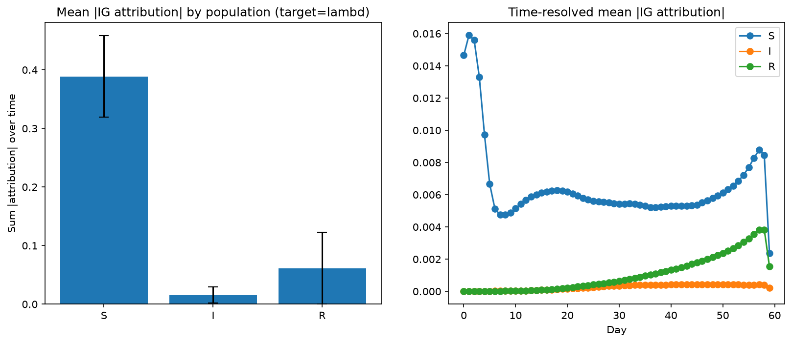
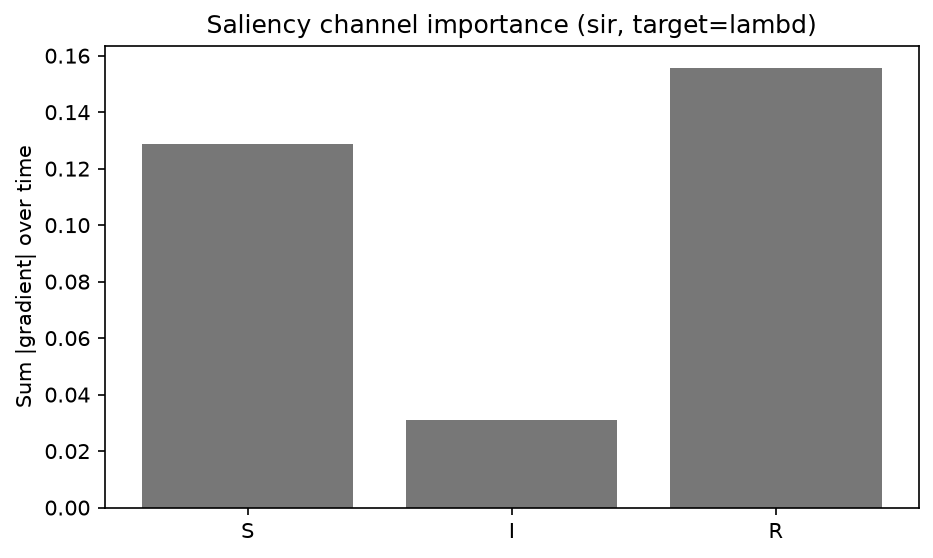
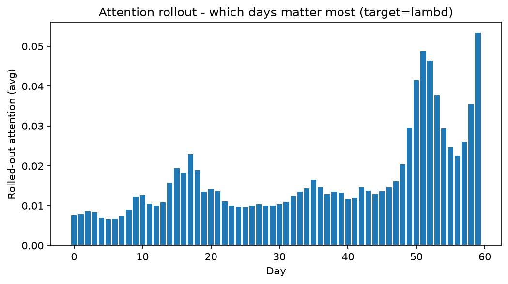
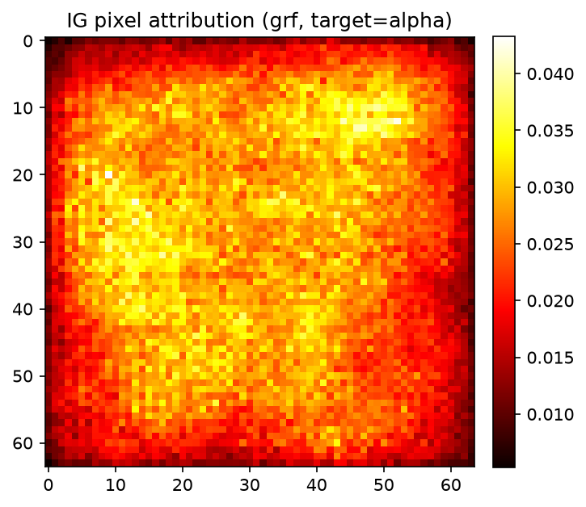
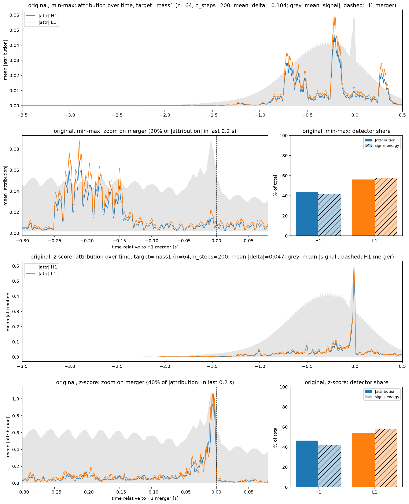
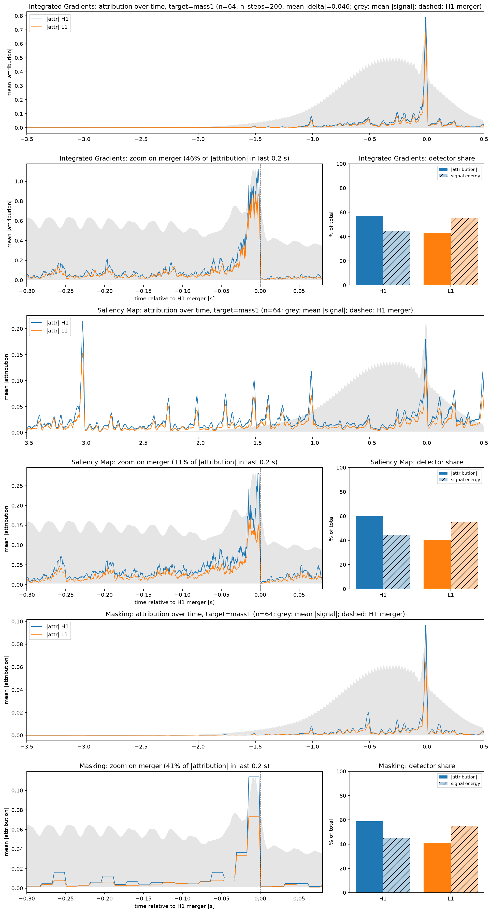

# What Do Neural Summary Networks Look At? Explaining Amortized Bayesian Inference with Attribution Methods

**Feriha Bircan** · Research internship project · October 2026  
Code: <https://github.com/ferihabircan/bayesflow-xai> · Project page: <https://ferihabircan.github.io/bayesflow-xai/>

## Abstract

Amortized Bayesian inference with BayesFlow compresses raw simulator output into a learned summary vector
before a conditional normalizing flow maps it to a posterior distribution. Whether that summary is built from
the physically meaningful part of the data is usually checked only indirectly, through parameter recovery and
simulation-based calibration. We apply four post-hoc explanation methods (Integrated Gradients, Saliency
Maps, Attention Rollout and Masking/Occlusion) to summary networks trained on four simulators: a stationary
SIR epidemic model, a sinusoidal toy signal ("Lotka-Volterra-style"), a Gaussian Random Field and a
gravitational-wave benchmark. To make gradient-based attribution possible, the methods are applied to
surrogate regressors that share the summary network's architecture. On the toy signal, Integrated Gradients
recovers the known ground truth: the channel scaled by the target parameter is the dominant channel in 188 of
200 samples. On the gravitational-wave benchmark, Integrated Gradients reveals that a network trained on
min-max-normalized inputs ignores the merger and relies on a non-physical ~20 Hz artefact introduced by the
simulator's whitening step; with z-score normalization the attribution moves onto the merger and validation
error drops from 9.27 to 1.41. On one trained gravitational-wave model, Integrated Gradients and Masking agree
closely (rank correlation 0.99 of their time profiles), whereas Saliency places 58% of its mass in
signal-free regions. The SIR experiments show the limits of the approach: methods disagree on which
population channel matters, and the recurrent read-out and the choice of baseline visibly shape the maps.

## 1 Introduction

Many scientific models are available only as simulators: given parameters $\theta$, one can draw data
$x \sim p(x \mid \theta)$, but the likelihood cannot be evaluated. Simulation-based inference (SBI) [3] learns
the posterior $p(\theta \mid x)$ from simulated pairs $(\theta, x)$ instead. Neural posterior estimation, as
implemented in BayesFlow [1, 2], trains two networks jointly: a *summary network* $s_\psi(x)$ that compresses a
data set into a fixed-size vector, and an *inference network*, a conditional normalizing flow
$q_\phi(\theta \mid s_\psi(x))$. Once trained, inference for a new data set is a single forward pass, so the
cost is *amortized* over all future data sets.

The quality of such a model is normally assessed with loss curves, parameter recovery and simulation-based
calibration (SBC). These checks establish whether the posterior is accurate *on simulated data*. They do not
show *which features of the data* the summary network uses. This matters because a network can reach a good
loss by exploiting a property of the simulator that will not be present in real observations; a related
concern, that SBI posteriors can be overconfident in ways the loss does not reveal, was raised by
Hermans et al. [10].

Post-hoc attribution methods from explainable AI (XAI) assign an importance score to every input element
for a given output. This project asks three questions:

1. Do attributions recover what is known to be informative when the ground truth is known?
2. Do different XAI methods agree with each other on the same trained model?
3. Can attributions reveal problems that the usual SBI diagnostics miss?

**Contributions.** (i) A plugin registry (`bayesflow_xai.registry`) in which simulators, summary networks,
inference networks and XAI methods are registered by name and combined from a YAML file. (ii) Experiments
with four XAI methods on four simulators, including the gravitational-wave benchmark from the
sbi-practical-guide [9]. (iii) The observation that, on that benchmark, Integrated Gradients exposes a
whitening artefact which the network trained on the original min-max normalization relies on, and a
comparison of three attribution methods on one model.

## 2 Background

### 2.1 Amortized Bayesian inference with BayesFlow

BayesFlow [1, 2] minimizes the expected negative log posterior density over the joint distribution of
parameters and simulated data,

$$
\min_{\psi,\phi}\; \mathbb{E}_{p(\theta)\,p(x\mid\theta)}\big[-\log q_\phi(\theta \mid s_\psi(x))\big],
$$

where $q_\phi$ is a normalizing flow (here an affine/spline coupling flow) conditioned on the learned summary
$s_\psi(x)$. The summary network encodes the structure of the data: recurrent or attention-based networks for
time series, convolutional networks for images. In BayesFlow 2 the whole pipeline (simulator, adapter that
transforms variables, summary and inference networks) is wrapped in a `BasicWorkflow`.

Two standard diagnostics are used here. *Parameter recovery* compares posterior medians with the true
parameters on held-out simulations. *Simulation-based calibration* checks that the rank of the true parameter
among posterior draws is uniformly distributed, which holds for a correctly calibrated posterior.

### 2.2 Attribution methods

Let $f: \mathbb{R}^d \to \mathbb{R}$ be the model output for one target parameter.

**Saliency Map** [5]. The absolute gradient $|\partial f / \partial x_i|$ at the input. It measures local
*sensitivity*: how much the output would change if $x_i$ were perturbed slightly. It needs one backward pass.

**Integrated Gradients (IG)** [4]. For a baseline $x'$,

$$
\mathrm{IG}_i(x) = (x_i - x'_i)\int_0^1 \frac{\partial f\big(x' + \alpha (x - x')\big)}{\partial x_i}\,d\alpha .
$$

IG satisfies *completeness*: $\sum_i \mathrm{IG}_i(x) = f(x) - f(x')$. The integral is approximated with
$n$ steps (Captum default $n = 50$ [8]); the difference between both sides of the completeness equation, the
*convergence delta*, measures the approximation error. The factor $(x_i - x'_i)$ means that IG measures
*contribution relative to the baseline*, not only sensitivity.

**Attention Rollout** [6]. For a Transformer with per-layer (head-averaged) attention matrices $A^{(l)}$, the
rollout is $\tilde A = \prod_l \big(\tfrac12 A^{(l)} + \tfrac12 I\big)$, with rows renormalized; the identity
term accounts for residual connections. It describes how information from each input position reaches each
output position, independently of which parameter is later read out.

**Masking / Occlusion** [7]. Replace a region (a time step, a time window or an image patch) with a baseline
value and record $|f(x) - f(x_{\text{masked}})|$. It needs only forward passes, one per region.

## 3 Method

### 3.1 Two model families

Every simulator is used for two models (Figure 1 on the project page):

1. **BayesFlow posterior.** A `BasicWorkflow` with a summary network and a coupling-flow inference network,
   evaluated with loss, recovery and SBC. The latent-space projection (UMAP and t-SNE of summary vectors) is
   computed on this summary network.
2. **Surrogate regressor.** A plain PyTorch summary network of the same family plus a linear head, trained
   with mean-squared error to predict all parameters. A wrapper exposes a single scalar output (one target
   parameter) so that Captum's attribution methods can be applied.

The surrogate is needed because Captum requires a plain `torch.nn.Module` with a differentiable scalar
output; the BayesFlow model's output is a distribution. **All attribution maps in this report therefore
describe a point-estimate network of the same architecture, not the normalizing-flow posterior itself.**

### 3.2 Registry

`bayesflow_xai.registry` holds four dictionaries, `SIMULATORS`, `SUMMARY_NETWORKS`, `INFERENCE_NETWORKS` and
`XAI_METHODS`, filled by decorators in `bayesflow_xai.registrations`. A simulator is described by a
`SimulatorSpec` (parameter names, input kind `timeseries` or `image`, a dataset builder and shape
information). `scripts/run_workflow.py` reads a YAML file naming one entry from each registry, trains the
surrogate (`train_generic_surrogate`, Adam, learning rate $10^{-3}$, 10% validation split) and calls the
selected XAI method.

### 3.3 Simulators and networks

**SIR epidemic model.** The stationary SIR model of the BayesFlow tutorial, in discrete time with
population $N = 83\cdot10^6$: new infections $C_t = \lambda I_t S_t / N$, $S_{t+1} = S_t - C_t$,
$I_{t+1} = I_t + C_t - \mu I_t$, $R_{t+1} = R_t + \mu I_t$. Reported cases over a 60-day window start after a
reporting delay $D$ and follow a negative binomial with mean $C_t$ and dispersion $\psi$. Priors:
$\lambda \sim \mathrm{LogNormal}(\log 0.4, 0.5)$, $\mu \sim \mathrm{LogNormal}(\log 1/8, 0.2)$,
$D \sim \mathrm{LogNormal}(\log 8, 0.2)$, $I_0 \sim \mathrm{Gamma}(2, 20)$, $\psi \sim \mathrm{Exp}(\text{mean } 5)$.
The BayesFlow model uses a GRU summary network (64 hidden units, 8-dimensional summary) and a spline
coupling flow of depth 2 on $\log(1+\cdot)$-transformed cases and parameters, trained offline on 6000
simulations for 100 epochs (batch size 64, early stopping with patience 10). The XAI surrogates instead see the
noise-free normalized trajectories $S/N, I/N, R/N$ (shape $60 \times 3$) and regress $\log(1+\theta)$: a GRU
surrogate (6000 simulations, 60 epochs), a GRU from the registry (2000 simulations, 40 epochs) and a Transformer
(model width 32, 4 heads, 2 layers, mean pooling; 4000 simulations, 60 epochs).

**Lotka-Volterra-style toy signal.** Despite its name, this simulator (taken from an example provided by the supervisor) is not the
predator-prey ODE. With $\theta \sim \mathcal{U}(-1, 1)^3$ and 20 time points $t \in [0, 1]$, channel
$k \in \{1, 2\}$ is $X_k(t) = \theta_{k-1} \sin\big(2\pi t (1 + \theta_2)\big) + 0.05\,\varepsilon$. Hence
$\theta_0$ affects only $X_1$, $\theta_1$ only $X_2$, and $\theta_2$ (frequency) both: a case where the correct
attribution is known. A GRU surrogate is trained on 6000 simulations.

**Gaussian Random Field (GRF).** The spatial example of the BayesFlow documentation: a $64 \times 64$ field
with power spectrum $P(k) = k^{-\alpha}\,\sigma^2$, $\log\sigma \sim \mathcal{N}(0, 1)$,
$\alpha \sim \mathcal{N}(4, 0.5)$. The BayesFlow model uses a convolutional summary network (widths 8–64,
max-pooling, 6-dimensional summary) and a coupling flow, trained online for 20 epochs × 1000 batches of 32.
The repository also reproduces the tutorial's conditional diffusion model (ResidualUViT) that generates
fields given $(\log\sigma, \alpha)$. The XAI surrogate is a CNN of the same shape trained on 2000 fields for
30 epochs; the target is $\alpha$.

**Gravitational wave (GW).** The original `GravitationalWaveBenchmarkSimulator` of the sbi-practical-guide
[9], vendored unchanged: a binary black-hole merger (PyCBC, IMRPhenomPv2) with
$m_1 \sim \mathcal{U}(40, 80)$ and mass ratio $q = m_2/m_1 \sim \mathcal{U}(0.25, 0.99)$, projected onto the
LIGO H1 and L1 detectors, with simulated aLIGO noise, whitened and high-passed at 20 Hz; 4 s at 2048 Hz
(8192 samples per detector), aligned so that the H1 merger is at $t = 0$ (3.5 s into the window). The summary
network is the "PaperEmbedding" from the same source [10]: a $1\times1$ convolution followed by 13 dilated
convolutions (kernel 2, dilations $2^0 \dots 2^{12}$, 16 channels, SELU), mapping 8192 samples to a
16-dimensional output. Surrogates are trained on 5000 simulations for 40 epochs (batch size 32) with
either the original global min-max normalization or a global z-score normalization of the strain. The target
is $m_1$.

### 3.4 XAI settings

IG uses a zero baseline for SIR, the toy signal and the GRF (50 steps), and the zero-strain level
(the median input value) with 200 steps for GW. Saliency is the absolute input gradient. Masking sets single
time steps (all channels together) or $8\times8$ patches to zero for SIR and the GRF; for GW it sets
32-sample windows (15.6 ms) of one detector at a time to the zero-strain level. For the SIR and toy-signal
statistics, the first and last time step are excluded from the "most important time step" rankings (see
§5.3).

## 4 Experiments and Results

All numbers are taken from the figures, logs and summaries committed to the repository. Training times were
measured on one NVIDIA RTX 2080 Ti (SIR posterior: 8.9 min; GRF posterior: 44 min; GRF diffusion model:
89 min).

### 4.1 Posterior quality

For SIR (300 test data sets, 1000 posterior draws each) parameter recovery is near-perfect for the infection
rate $\lambda$ (correlation $r = 0.98$), good for $\psi$ ($r = 0.86$) and $I_0$ ($r = 0.74$), and weak for the
recovery rate $\mu$ ($r = 0.18$) and the delay $D$ ($r = 0.41$). For the latter two the posterior intervals
remain wide, which is the expected behaviour for weakly identified parameters rather than a failure. The SBC
rank histograms of all five parameters stay inside the confidence band. The UMAP and t-SNE projections of 2000
summary vectors form a one-dimensional curve ordered by $\lambda$. For the GRF, recovery is near-perfect for
both parameters ($r = 0.999$ for $\log\sigma$, $0.993$ for $\alpha$) and the ECDF calibration curves stay inside
the 95% band.

### 4.2 Surrogate fit

A surrogate explanation is only meaningful for parameters the surrogate actually predicts. Held-out $R^2$
values (recomputed on CPU for this report with the repository's training code and seeds):

| Surrogate | Parameter | $R^2$ |
|---|---|---|
| SIR GRU (6000 sims) | $\lambda$ | 0.90 |
| | $\mu$, $D$, $I_0$, $\psi$ | −1.16, 0.02, 0.03, −0.01 |
| Toy-signal GRU (6000 sims) | $\theta_0$, $\theta_1$, $\theta_2$ | 0.98, 0.99, 0.97 |

The SIR surrogate learns only $\lambda$. Its targets are not standardized, so the loss is dominated by the two
high-variance parameters $I_0$ and $\psi$ (variance ≈ 0.6 each on the $\log(1+\cdot)$ scale), of which $\psi$
cannot be identified from noise-free S/I/R trajectories at all. All SIR explanations below therefore target
$\lambda$. The GW surrogates reach validation MSE 9.27 (min-max) and 1.41 / 0.60 (z-score, two data seeds).

### 4.3 Toy signal: recovering a known ground truth

For target $\theta_0$, which by construction scales only $X_1$, IG assigns the larger total attribution to
$X_1$ in **188 of 200** validation samples. Among interior time steps, the most important ones cluster around
steps 3–6 and 13–17, i.e. around the extrema of the sine, where the amplitude is easiest to read.

### 4.4 SIR: methods disagree on the channel

| Method (target $\lambda$) | Channel ranking | Location in time |
|---|---|---|
| IG, zero baseline, 200 samples | S ≫ R > I (0.39 / 0.06 / 0.02) | days 0–3 and 50–58 |
| IG statistics, 50 samples | S dominant in 48/50 | interior top-5: days 1–2, 17–25, 54–59 |
| Saliency | R > S ≫ I (0.16 / 0.13 / 0.03) | – |
| Masking (per day) | – | rises toward the last day; bump at days 1–4 |
| Attention Rollout (Transformer) | – | days 49–53 and the last day |

The paired t-tests on per-sample channel importance under IG are all significant ($p < 10^{-27}$), so the
S-dominance is not noise. However, Saliency, which differs from IG mainly by the factor
$(x_i - x'_i)$, ranks R first. Since $S/N \approx 1$ over most of the window while $I/N$ is a few percent,
the zero baseline gives S a much larger multiplier than I. The S-dominance under IG is therefore at least in
part an effect of the baseline. The Transformer is trained on all five parameters jointly, so its rollout is the
same for every target.

### 4.5 GRF: diffuse attribution

Mean IG and Saliency maps for $\alpha$ are spread over the interior of the field with a dark frame of a few
pixels; the $8\times8$ masking map shows the lowest importance in the leftmost and rightmost patch columns.
This matches the role of $\alpha$, a global property (spatial correlation) of the whole field. The dark border
is consistent with zero padding in the convolutions, which gives border pixels fewer receptive fields.

### 4.6 Gravitational wave: a whitening artefact

With identical simulated data (5000 simulations, data seed 0) and identical training, only the input
normalization differs:

| Normalization | Val. MSE | IG peak | Samples peaking within ±50 ms of merger | IG share in last 0.2 s |
|---|---|---|---|---|
| min-max (original) | 9.27 | −212 ms | 0% | 20% |
| z-score | 1.41 | −4.9 ms | 100% | 40% |

With min-max inputs, IG attribution sits in sharp blocks around −0.7 s, −0.2 s and +0.3 s, where the merger
contributes almost nothing. Tracing the simulator stage by stage (`scripts/plot_gw_samples.py`) explains why:
PyCBC starts the waveform below 20 Hz, where the noise PSD has no power. The whitening step estimates the PSD
from the data itself and therefore *amplifies* the sub-20 Hz inspiral (standard deviation at −1 s increases from
33 for whitened noise alone to $2.5\cdot10^5$). The 20 Hz FIR high-pass reduces it only about six-fold. Every
sample is dominated by a nearly monochromatic ~20 Hz oscillation with a bell-shaped envelope from −1.5 s to
+0.5 s, extending past the merger, and the physical chirp is visible only in the last ~50 ms. Min-max scaling
spends almost the entire $[0, 1]$ range on this artefact. The simulator was deliberately left unmodified;
the artefact is a finding of the analysis.

### 4.7 Gravitational wave: three methods on one model

On one z-score model (data seed 42, validation MSE 0.60; 64 validation samples):

| | Integrated Gradients | Saliency | Masking |
|---|---|---|---|
| Peak of mean attribution | −5.4 ms | −3010 ms | −10.7 ms |
| Samples peaking within ±50 ms of merger | 97% | 25% | 100% |
| Share in last 0.2 s | 46% | 11% | 41% |
| Share in early inspiral (−3.5 to −1 s) | 7.5% | 58% | 7.8% |
| Share after merger (+0.05 to +0.5 s) | 13% | 17% | 14% |
| H1 / L1 attribution | 57 / 43 | 60 / 40 | 59 / 41 |

Signal energy is split 45 / 55 between H1 and L1. The rank correlation of the time profiles is
0.99 between IG and Masking and 0.47 for both pairs involving Saliency. IG's mean absolute convergence delta is
0.046, against a mean $|f(x) - f(x')|$ of 12.3. Saliency's peaks in the signal-free early window fall on a
regular 0.25 s grid (512 samples $= 2^9$, one of the embedding's dilation factors), which suggests an
architectural origin; this was observed, not tested.

## 5 Discussion

### 5.1 Attributions can expose problems the diagnostics do not

The min-max GW model trains normally; only the attribution analysis showed that it was not using the merger.
Following the attribution back into the simulator located the cause. This is the main practical argument for
adding attribution to an SBI workflow: it checks *what* a network learned, which loss, recovery and
calibration on simulated data cannot.

### 5.2 Method agreement is more informative than any single map

IG and Masking agree almost perfectly on the GW model although one uses gradients along a path and the other
only forward passes. Both measure change relative to the zero-strain baseline, so signal-free regions score
near zero by construction. Saliency measures sensitivity, which can be high where the input carries no
signal. On SIR, where the methods disagree, no single map should be taken at face value.

### 5.3 Architecture and baseline leave fingerprints

Several patterns come from the model or the method rather than the data: the GRU surrogates read only the
final hidden state, so the last time step reaches the output through a single update and dominates
attributions (according to the code documentation, the last step is the arg-max in all samples under both a zero and a mean
baseline, which is why endpoints are excluded from the rankings); the zero baseline favours large-magnitude
channels under IG; zero padding darkens the GRF borders; and the dilated GW embedding leaves a periodic grid in
Saliency.

### 5.4 Detector preference is not robust

The H1 preference of 57–60% holds across the three methods for one model, but an earlier z-score model
(data seed 0) had H1/L1 = 46/54 IG attribution, close to its signal energy (42/58). The detector preference is
a property of an individual training run, not a physical result.

## 6 Limitations

- **Surrogates, not the posterior.** Attributions are computed on MSE regressors of the same architecture, not
  on the BayesFlow summary network and flow. For SIR the surrogate also sees noise-free S/I/R trajectories
  instead of the noisy case counts the posterior is trained on.
- **Partial surrogate fit.** The SIR surrogate explains only $\lambda$; unstandardized targets leave $\mu$ and
  $D$ unlearned, although $\mu$ is in principle identifiable from noise-free trajectories.
- **Single runs.** Most results come from one seed. The two z-score GW trainings differ by more than a factor
  of two in validation MSE.
- **No quantitative faithfulness evaluation.** Methods are compared with each other and with known structure,
  not with deletion/insertion curves or model-randomization tests.
- **Baselines.** IG used a zero baseline for SIR, the toy signal and the GRF; alternatives were only tried for
  the endpoint check.

**Future work.** Attributing directly through the BayesFlow summary network (e.g. to a summary statistic or to
a posterior moment), standardizing surrogate targets, repeating key results over several seeds, adding
faithfulness metrics, and comparing baselines systematically.

## 7 Conclusion

Attribution methods are a useful complement to the standard SBI diagnostics. On a toy problem they recover the
known structure, and on a realistic gravitational-wave benchmark Integrated Gradients revealed that a network
relied on a simulator artefact rather than on the physical signal, which led to a better-performing
normalization. The experiments also show that attributions depend on the architecture, the baseline and the
training run, and should be interpreted through agreement between methods rather than one map at a time.

## Reproducibility

All code, configurations and figures are in the repository. `pytest` runs the unit tests; every pipeline can
be run with reduced settings on a CPU (`scripts/run_workflow.py --n_sims 200 --epochs 2`). During review for
this report, a bug in the SIR simulator's recovered-compartment update (recoveries computed from the
*updated* rather than the previous infected count, so that $S + I + R$ exceeded $N$ by up to ~9%) was fixed;
it affected only the R trajectory seen by the XAI surrogates, not the case counts used by the BayesFlow
posterior. The SIR surrogate figures were regenerated on a CPU after the fix; the qualitative results
(S dominant under IG in 48 of 50 samples; R ranked first by Saliency) did not change.

## References

1. S. T. Radev, U. K. Mertens, A. Voss, L. Ardizzone, U. Köthe. BayesFlow: Learning complex stochastic models
   with invertible neural networks. *IEEE Transactions on Neural Networks and Learning Systems*, 2020.
2. S. T. Radev, M. Schmitt, L. Schumacher, et al. BayesFlow: Amortized Bayesian workflows with neural networks.
   *Journal of Open Source Software*, 2023.
3. K. Cranmer, J. Brehmer, G. Louppe. The frontier of simulation-based inference. *PNAS*, 2020.
4. M. Sundararajan, A. Taly, Q. Yan. Axiomatic attribution for deep networks. *ICML*, 2017.
5. K. Simonyan, A. Vedaldi, A. Zisserman. Deep inside convolutional networks: Visualising image classification
   models and saliency maps. *ICLR Workshop*, 2014.
6. S. Abnar, W. Zuidema. Quantifying attention flow in transformers. *ACL*, 2020.
7. M. D. Zeiler, R. Fergus. Visualizing and understanding convolutional networks. *ECCV*, 2014.
8. N. Kokhlikyan et al. Captum: A unified and generic model interpretability library for PyTorch.
   arXiv:2009.07055, 2020.
9. M. Deistler et al. Simulation-based inference: A practical guide. arXiv preprint, 2025.
   Code: <https://github.com/sbi-dev/sbi-practical-guide>.
10. J. Hermans, A. Delaunoy, F. Rozet, A. Wehenkel, V. Begy, G. Louppe. A trust crisis in simulation-based
    inference? Your posterior approximations can be unfaithful. *Transactions on Machine Learning Research*,
    2022.

## Appendix: Figures

All figures are in `docs/figures/` (shown on the project page) and `outputs/figures/`.

*Figure A1. SIR parameter recovery (BayesFlow posterior).*

*Figure A2. SIR simulation-based calibration.*

*Figure A3. Toy signal, IG statistics for $\theta_0$ over 200 samples.*

*Figure A4. SIR, Integrated Gradients for $\lambda$ by channel and over time.*

*Figure A5. SIR, Saliency by channel.*

*Figure A6. SIR, Attention Rollout per day.*

*Figure A7. GRF, mean IG attribution for $\alpha$.*

*Figure A8. GW, IG over time with min-max (top) and z-score (bottom) inputs.*

*Figure A9. GW, IG vs. Saliency vs. Masking on one z-score model.*
